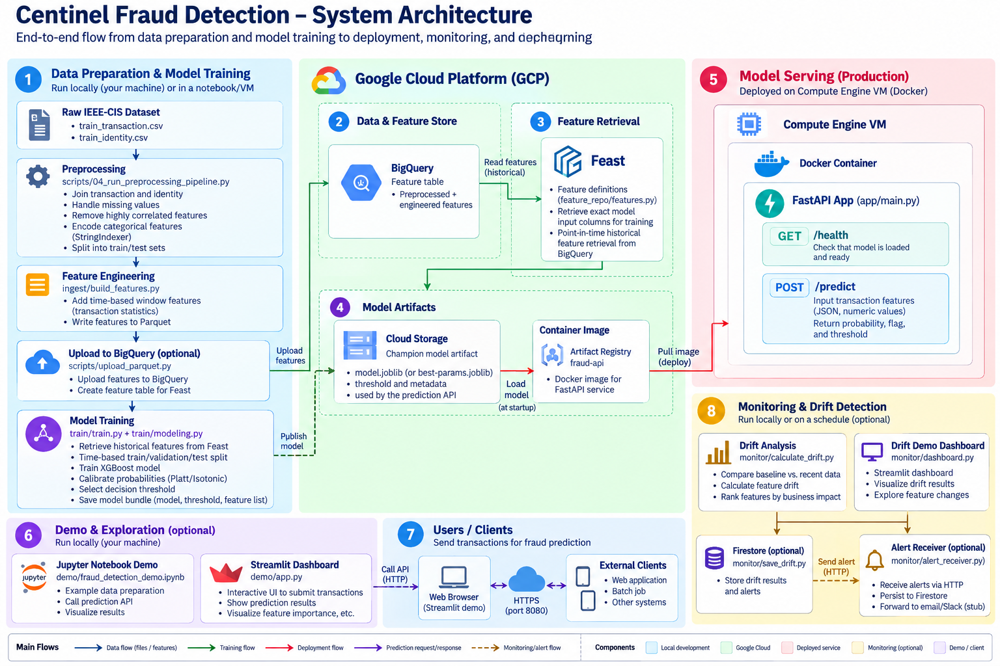

# Cost-Weighted Fraud Detection on GCP

A fraud-detection pipeline built around reproducible data preparation, XGBoost model training and calibration, and a FastAPI inference service. The production inference service is deployed as a **Docker container on a single Google Compute Engine VM**. The trained model artifact remains in Google Cloud Storage (GCS), separate from the container image.

## What is included

- Reproducible preprocessing for the IEEE-CIS fraud dataset
- Local ingestion and feature engineering
- Feast configuration for GCP and local development
- XGBoost training, calibration, evaluation, and model promotion helpers
- FastAPI scoring service with GCS-backed champion-model loading
- Cost-weighted drift-monitoring utilities
- Streamlit demo app and synthetic drift-seeding script
- Docker image build and single-VM deployment tooling for GCP

## Architecture and deployment scope

The diagram below is the full picture: an offline pipeline that produces a model, a single production service that scores transactions, and optional tooling for demos and drift monitoring. The production piece is intentionally small — a Docker container on a regular Compute Engine VM, with no container orchestrator involved.



**In short:** stages 1–4 (bottom-left to top-middle) run offline and end with two artifacts sitting in GCP — a trained model in Cloud Storage and a scorer image in Artifact Registry. Stage 5 is the only stage that serves live traffic: a Compute Engine VM pulls both artifacts and runs the FastAPI scorer. Stages 6–8 are optional — a local demo console, the clients that call the scorer, and a drift-monitoring loop — and none of them sit in the request path of stage 5.

### Stage by stage

**1. Data preparation & model training** *(local / notebook / VM)* — Join the raw IEEE-CIS CSVs, clean and encode them, engineer rolling velocity and merchant-risk features, then train and calibrate the XGBoost model and pick a decision threshold. Nothing here needs GCP to be reachable except the optional BigQuery upload.  
Code: `scripts/04_run_preprocessing_pipeline.py`, `ingest/build_features.py`, `train/train.py` / `train/modeling.py` / `train/grid_search.py`.

**2. Data & feature store (BigQuery)** — The engineered features land in a BigQuery table that acts as Feast's offline store: the single source of truth that both training and online feature retrieval read from.  
Code: `scripts/upload_parquet.py` writes the table named by `FEAST_BIGQUERY_TABLE`.

**3. Feature retrieval (Feast)** — Feast defines entities and feature views over that BigQuery table, giving point-in-time-correct historical retrieval for training plus a materialized online store for low-latency lookups.  
Code: `feature_repo/features.py`, `feature_repo/feature_store.yaml` (`feast apply` / `feast materialize-incremental`).

**4. Model artifacts** — The winning calibrated model bundle (model, feature list, threshold) is published to Cloud Storage as the "champion" artifact, independent of the serving container. Separately, the FastAPI scorer image is built and pushed to Artifact Registry.  
Code: `train/publish_champion.py` → `gs://<PROJECT_ID>-artifacts/models/champion/model.joblib`; `deploy/Dockerfile` + `deploy/vm/cloudbuild.yaml` → Artifact Registry image.

**5. Model serving (production)** — A Compute Engine VM runs one Docker container. On startup the container downloads the champion model from GCS using the VM's attached service account, then serves `GET /health` (readiness/threshold check) and `POST /predict` (score a transaction, return probability + threshold + flag). See [Deploy the trained model to GCP with Docker](#deploy-the-trained-model-to-gcp-with-docker) below for the exact commands.  
Code: `app/main.py`, `app/model_loader.py`; deployed by `deploy/vm/deploy-vm.ps1`.

**6. Demo & exploration** *(optional)* — A local Streamlit console scores a sampled transaction against the running FastAPI service and shows the cost-weighted drift leaderboard, without touching production traffic. This repository ships that console in place of a separate notebook/CLI demo app.  
Code: `demo/streamlit_app.py` (`make demo`), fed by `demo/prepare_drift_windows.py` and `demo/seed_drift_scenario.py` — see [Demo console](#demo-console-scoring--cost-weighted-drift-review) below.

**7. Users / clients** — Any HTTP client — the Streamlit demo, a web app, a batch job — calls the deployed scorer's `/predict` endpoint over HTTPS on port `8080` with JSON transaction features and gets back a probability, threshold, and flag.  
Code: `POST /predict` on the Compute Engine VM, consumed directly or via `demo/streamlit_app.py`'s "Scorer URL" setting.

**8. Monitoring & drift detection** *(optional)* — Baseline vs. recent production feature windows are compared feature-by-feature (KL divergence), weighted by SHAP-style model importance and fraud/false-positive cost assumptions, to rank drift by expected dollar impact. Once cumulative cost crosses a threshold, an alert is persisted and forwarded to a notification endpoint.  
Code: `monitor/cost_drift.py` (drift math) driven by `demo/run_drift_analysis.py --send-alert` or the Streamlit drift pane; `monitor/alerting.py` persists to Firestore and calls the HTTP endpoint in `gcp/alert_function/main.py` (deployed via `deploy/deploy-alert-function.ps1`).

> A few labels in the diagram (a notebook demo, `monitor/dashboard.py`, `monitor/calculate_drift.py`, `monitor/save_drift.py`, `monitor/alert_receiver.py`) are illustrative rather than literal filenames — the "Code" lines above point at what actually implements each responsibility in this repository.

### GCP components used by production serving (stage 5)

| Component | Purpose |
|---|---|
| Compute Engine (`e2-micro` starting point) | Runs the Docker container |
| Docker | Packages and runs the FastAPI scorer |
| Artifact Registry | Stores the scorer image |
| Cloud Storage | Stores the trained champion model artifact |
| VM service account | Grants the VM permission to pull the image and read the model |
| Cloud Logging / VM logs | Used to inspect service output and diagnose startup issues |

An `e2-micro` is a low-cost starting point, not a guaranteed fit for every model and workload. The model must fit in available memory alongside Python, FastAPI, and the web server. If the process is terminated for running out of memory or the VM becomes unstable, move to a larger machine type.

## Model training and evaluation

More detail in [MODEL_TRAINING_EVAL.md](docs/MODEL_TRAINING_EVAL.md)


## Deploy the trained model to GCP with Docker

More detail in [MODEL_DEPLOYMENT.md](docs/MODEL_DEPLOYMENT.md)


## Local development quick start

### 1. Create a Python 3.11 environment

```bash
python -m venv .venv
```

Activate the environment, then install the project dependencies:

```bash
pip install -r requirements.txt
```

### 2. Prepare the dataset

Place the Kaggle IEEE-CIS training files here:

```text
dataset/train_transaction.csv
dataset/train_identity.csv
```

Run the preprocessing stage:

```bash
python scripts/04_run_preprocessing_pipeline.py --output-root outputs/preprocessing-contract-v1
```

The preprocessing run preserves every required contract column through the
correlation filters and writes the fitted categorical mappings to
`outputs/preprocessing-contract-v1/prepared/categorical_mappings.json`.

Build the engineered features:

```bash
python ingest/build_features.py \
  --preprocessed-csv outputs/preprocessing-contract-v1/03_label_corr_filtered.csv \
  --categorical-mappings outputs/preprocessing-contract-v1/prepared/categorical_mappings.json \
  --output-dir data/staged/v1
```

This command applies those saved mappings, computes the rolling features, and
writes a contract-checked Parquet containing exactly the Feast model inputs
plus `card1`, `ts`, `TransactionDT`, `TransactionID`, and `isFraud`. It does not
upload to BigQuery unless `--bigquery-table` is supplied. Loads refuse to
replace an existing table unless `--replace-bigquery-table` is explicit.
The table also stores a SHA-256 fingerprint of the categorical mapping. Both
training commands compare that fingerprint with the supplied mapping artifact
and stop if the feature codes came from a different preprocessing run.

To verify the complete Parquet → BigQuery → Feast handoff safely, upload a
small sample to a new scratch table (choose a unique table ID):

```powershell
python ingest/build_features.py `
  --preprocessed-csv outputs/preprocessing-contract-v1/03_label_corr_filtered.csv `
  --categorical-mappings outputs/preprocessing-contract-v1/prepared/categorical_mappings.json `
  --sample-rows 5000 `
  --output-dir outputs/contract-handoff `
  --bigquery-table fraud-cost-pipeline.fraud_features.features_contract_check_20261018 `
  --feast-sample-check
```

The check uses a temporary local Feast registry, so it reads that scratch table
without changing the production registry or online store. It leaves the scratch
table in BigQuery for inspection.

### 3. Prepare features and train

Apply and materialize the Feast feature repository using the configured project and data sources:

```bash
feast -c feature_repo apply
feast -c feature_repo materialize-incremental 2026-07-26T00:00:00
```

Upload the staged parquet data to BigQuery:

```bash
python scripts/upload_parquet.py
```

Train a model:

```bash
python train/train.py --output outputs/model.joblib
```

Search XGBoost hyperparameters using a chronological holdout from the training split, then retrain the best configuration and evaluate it on the time-based validation/test splits:

```bash
python train/grid_search.py --output outputs/model-grid-search.joblib
```

Each parameter combination is logged as a child MLflow run, and the selected
model, metrics, and search CSV are logged on the parent run. By default,
tracking metadata is stored in `outputs/mlflow.db`, and artifacts are stored
in `mlruns/`; open the experiment with:

```bash
mlflow ui --backend-store-uri sqlite:///outputs/mlflow.db --host 127.0.0.1 --port 5000
```

Set `MLFLOW_TRACKING_URI` (and optionally `MLFLOW_EXPERIMENT_NAME`) in `.env`
to send runs to a shared MLflow tracking server. MLflow tracks experiments;
the scorer still loads the champion bundle from GCS after publishing it.

The search writes `outputs/model-grid-search.grid-search.csv` and per-run `config.json` and `result.json` files under `outputs/model-grid-search.grid-search-runs/`. Use `--search-validation-fraction` to change the chronological holdout size.

### 4. Run the API locally

```bash
uvicorn app.main:app --host 0.0.0.0 --port 8080
```

The production container listens on port `8080`. Configure the model source through the environment rather than relying on a developer-specific absolute file path.


## Demo console: scoring + cost-weighted drift review

`demo/` contains a self-contained Streamlit console plus the CLI helpers used to prepare its inputs. It is meant for local walkthroughs of the two things this pipeline cares about: scoring a transaction and watching for feature drift that is expensive in fraud-cost terms, not just statistically significant.

| File | Purpose |
|---|---|
| `demo/streamlit_app.py` | Two-pane console: score a sampled row from the prepared test CSV against the live FastAPI scorer, and view a cost-weighted drift leaderboard comparing a baseline window to a production window. |
| `demo/prepare_drift_windows.py` | Builds the `baseline_window.parquet` / `production_window.parquet` / `shap_importance.json` inputs the console reads, aligned to a trained model's feature schema. Either splits one historical Parquet file chronologically by `TransactionDT` (`--source`), or accepts two already-separated windows (`--baseline` / `--production`). |
| `demo/seed_drift_scenario.py` | Synthetic drift generator: shifts one numeric feature by a configurable number of standard deviations for a fraction of rows, so you can demo the drift leaderboard and alerting without waiting on real production drift. |
| `demo/run_drift_analysis.py` | CLI equivalent of the drift leaderboard pane. Ranks features by estimated dollar cost of drift (using the cost-weighted drift utilities in `monitor/cost_drift.py`) and, with `--send-alert`, persists/forwards an alert through `monitor/alerting.py` once cumulative cost crosses a threshold. |

### Running the console

```bash
make demo
# equivalent to:
streamlit run demo/streamlit_app.py
```

The sidebar exposes the settings below (each also configurable via environment variable, loaded from `.env` through `config/env.py`):

| Setting | Env var | Default | Notes |
|---|---|---|---|
| Scorer URL | `SCORER_URL` | `http://localhost:8080` | Base URL for the FastAPI service; the console calls `/health` and `/predict`. Start it with `make score`. |
| Prepared test CSV | `TEST_DATA_CSV` | `outputs/preprocessing/prepared/test_prepared.csv` | Source of sample rows for the scoring pane; produced by the preprocessing pipeline in step 2 above. |
| Drift data directory | `DEMO_DATA_DIR` | `outputs/demo` | Must contain `baseline_window.parquet`, `production_window.parquet`, and `shap_importance.json`, produced by `demo/prepare_drift_windows.py`. |

The scoring pane sends the selected row as named model features to `/predict` and shows the returned fraud probability, decision threshold, and flag status. The drift pane computes a per-feature KL divergence between the two windows, weighs it by SHAP-derived feature importance and the configured fraud-cost assumptions (`p_fraud`, false-negative cost, false-positive cost), and charts the top offending features by estimated dollar impact.

### End-to-end example

```bash
# 1. Start the scorer in a separate terminal
make score

# 2. Build baseline/production windows and importance weights from a trained
#    model and a historical feature dataset (chronological split)
python demo/prepare_drift_windows.py \
  --source data/staged/v1/features.parquet \
  --model outputs/model.joblib \
  --output-dir outputs/demo

# 3. Optional: inject synthetic drift into one feature for the demo
python demo/seed_drift_scenario.py \
  --baseline outputs/demo/baseline_window.parquet \
  --output outputs/demo/production_window.parquet \
  --feature merch_fraud_rate_30d

# 4. Launch the console
make demo
```

To rank drift from the command line instead of (or in addition to) the Streamlit pane, including sending an alert when the cumulative cost-weighted drift crosses the configured threshold:

```bash
python demo/run_drift_analysis.py \
  --baseline outputs/demo/baseline_window.parquet \
  --production outputs/demo/production_window.parquet \
  --importance outputs/demo/shap_importance.json \
  --top 10 \
  --send-alert
```
